# Anomaly Studio — Version 0.7

## Description

A native Rust editor for S.T.A.L.K.E.R. Anomaly mod authors, combining UI layout editing and icon definition editing in one application. This repository is now the home of the combined studio and replaces the standalone UI Studio application.

## Preview

The following screenshots show the earlier UI Studio and Icon Studio interfaces. Version 0.7 adds the shared mode bar and direct source saving.

<table>
  <tr>
    <th width="50%">UI Editor</th>
    <th width="50%">Icons Editor</th>
  </tr>
  <tr>
    <td>
      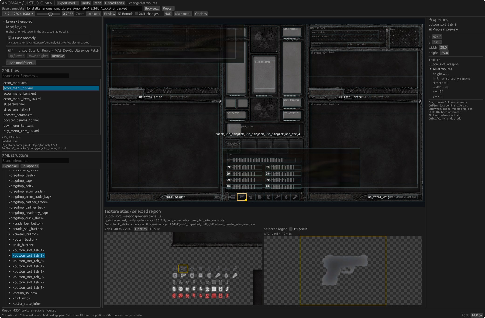
    </td>
    <td>
      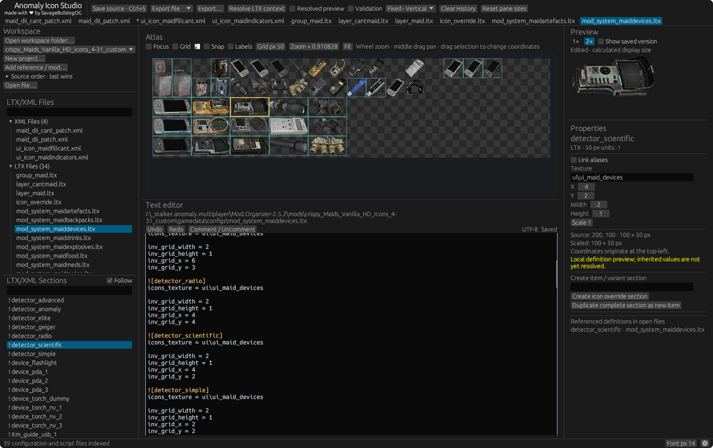
    </td>
  </tr>
</table>

[more screenshots](https://github.com/SBDG-0/crispy_Anomaly_UI_Studio#more-screenshots)

## Getting started

Build with `./build.ps1 -Test`, then open `dist/Anomaly Studio v0.7.exe`. Existing standalone UI Studio releases remain available in the [repository releases](https://github.com/SBDG-0/crispy_anomaly_ui_studio/releases); tagged combined releases are built automatically by GitHub Actions.

Choose the mod folder or its `gamedata` folder using the source controls. Select **UI Editor** or **Icons Editor** at the top. Both modes edit the files you open directly: **Save source / Ctrl+S** writes to the displayed source path, creates a timestamped backup, and refuses to overwrite an external change. No output mod folder or export step is required.

## Two editing modes

- **UI Editor:** browse XML files and their element hierarchy, move/resize existing geometry, edit numeric properties, inspect texture atlases, and save the opened XML directly. Undo/redo remains available after saving. Discard edits restores the last saved state.
- **Icons Editor:** browse LTX/XML definitions, edit atlas rectangles and source text, resolve LTX context, and save the opened file directly. Full-file and DLTX/Icon Override/DXML exports remain optional tools.
- Switching modes retains unsaved work, selection, zoom and history. An asterisk marks unsaved edits, and closing checks both modes.
- Select a textured UI element and choose **Edit icon definition** to open its descriptor and matching region in Icons. Save the definition, then return to UI Layout to refresh its atlas preview.
- Both sidebars use the same Layers controls, full-width file/section rows, and a draggable split between the two lists. XML hierarchy expansion stays available in UI Layout.
- **UI Editor** and **Icons Editor** share the bottom-right Font control and settings button. Right-click the Font value to restore 14 px. Font size changes the whole app, including source text, headings, lists and popups; the keybind popup is available in either mode. **Keyboard Shortcuts** groups bindings under **UI Editor** and **Icons Editor**. Choose canvas modifiers inline; click the comment shortcut to record a chord. Each row has Reset, and Reset all restores defaults in the draft. Save applies and remembers changes; Cancel or closing discards them. The author credit stays at the top-right. Icons starts in **Fixed – Vertical** layout; other layout choices remain available.

In Icons, single-clicking a file opens a temporary preview tab with muted orange text. Double-click the file or edit it to keep the tab. Tabs shrink to about three readable characters before becoming a horizontal carousel. The broom at the end clears saved inactive tabs while keeping the current file and unsaved work. Undo, Redo, Discard edits and a changed-line count are available in the Icons toolbar. Arrow keys stay within the file or section/element list you clicked, and file lists scroll with keyboard selection. XML trees use Up/Down for visible rows, Left/Right for parent/child navigation and expansion, and Enter to expand/collapse. Icons shows an XML tree in its sections pane for XML files and its section list for LTX files. Both XML trees provide Expand all / Collapse all. Clicking an Icons tree node or LTX section selects its source line; Icons Follow also follows keyboard navigation. UI Editor Follow reveals the canvas-selected element in its tree. UI Editor history tabs will follow after review of the Icons behavior.

Floating panes and settings use a darker shared palette, a subtle shadow and a thin focus outline. Drag the Keyboard Shortcuts title bar to move the window within the app.

## Sources and saves

The last enabled source wins for each relative file. Both modes use the same Layers panel: enable/disable sources, add/remove mods, and move them up or down. The last enabled layer wins in both browsers. Save or discard pending UI geometry edits before changing layers. Type a path and click Rescan, or use Browse; a fresh session has no default personal folder.

The opened file's displayed path is the save destination, including files supplied by another enabled mod. Sources remain local in `studio-layers.txt`; the shared font size is stored in `studio-appearance.txt`, and keybind settings in `studio-settings.txt`. Icon view and recovery metadata remain app-local. Icon recovery runs in the background even while UI Layout is active. Both editors copy pending edits into `.studio-recovery` every 15 seconds and on normal exit. Direct Save remains the normal way to keep changes.

Direct save preserves XML comments, includes, whitespace, attribute order, UTF-8 BOM and Windows-1251 encoding. Same-file changes in both modes are not automatically merged: save detects external changes rather than overwriting them. Reload a clean file to pick up the latest disk contents.

## Controls and limits

By default, UI Editor uses Ctrl+wheel to zoom, middle-button drag to pan, Ctrl/Strg to constrain movement, Shift for finer movement, and Alt during resizing to preserve proportions. Canvas modifiers can be changed independently for each editor in Keyboard Shortcuts. Fit view is explicit. Output presets change the preview, not XML coordinates or paired `_21` layouts. Icons retains its grid, snapping, source editing and patch-export controls.

DDS images are inspected rather than painted. The layout preview approximates engine behavior; runtime scripts, complete DXML execution, generated controls, exact game fonts, and include composition are not simulated. Verify saved layouts in-game.

## Errors and recovery

Expected file and save errors are shown in the editor status. An unexpected caught editor error opens an error dialog and pauses that editor while retaining both sessions in memory. The dialog identifies the local `studio-error.log` and recovery copies, and offers copying the error details, using the other editor or retrying. Unsaved buffers are copied to `.studio-recovery`; each copy has an origin sidecar identifying its original source. Recovery writes separate files rather than replacing mod sources.

The error log rotates at 2 MiB. Startup failures are reported in a native error dialog. Diagnostics stay local; nothing is uploaded automatically. Guards handle recoverable Rust panics; deadlocks must be prevented directly, and native process termination cannot be caught by a Rust panic guard.

## Build and development

Use Rust with a working Windows linker and resource compiler (`windres` on GNU, Windows SDK `rc` on MSVC). Dependencies are pinned in Cargo.lock. Run `./build.ps1 -Test`; add `-Offline` to use cached dependencies. The script tests the workspace and builds `dist/Anomaly Studio v0.7.exe`.

The [architecture guide](docs/architecture.md) describes the shared core and editor boundaries. [Changelog](CHANGELOG.md) records the migration. Historical [UI Studio 0.6](docs/ui-studio-0.6.md) and [Icon Studio 0.2](docs/icon-studio-0.2.md) guides preserve detailed controls and earlier screenshots; their standalone/export-only instructions do not describe the current workflow.

`anomaly-studio --audit <folder>` performs the read-only DDS/LTX/XML audit.

## Automatic releases

Pushing a `v*` version tag runs the Windows release workflow. Tags such as `v0.7` and `v0.7.0` must match the root Cargo.toml version. The workflow checks formatting, tests the workspace, builds Windows x64, and publishes the executable, a ZIP with documentation/licenses, and SHA-256 checksums. Release notes include the features from this README and the matching version entry from CHANGELOG.md. Missing or mismatched version notes fail before publication.

The workflow uses GitHub's built-in token; no personal token is required. Manual runs from Actions produce downloadable build artifacts without publishing a release. The tagged commit must include `.github/workflows/release.yml` and the release preparation script. A failed upload leaves a draft that can be resumed by rerunning the workflow; existing published releases are not overwritten.

## More screenshots

The following screenshots show the earlier UI Studio and Icon Studio interfaces. Version 0.7 adds the shared mode bar and direct source saving.

<table>
  <tr>
    <td width="33%">
      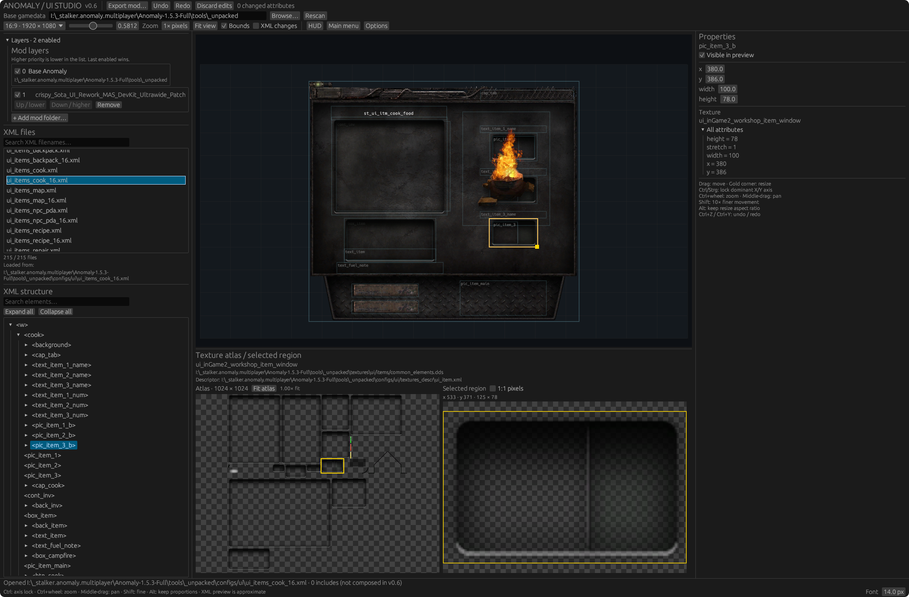
    </td>
    <td width="33%">
      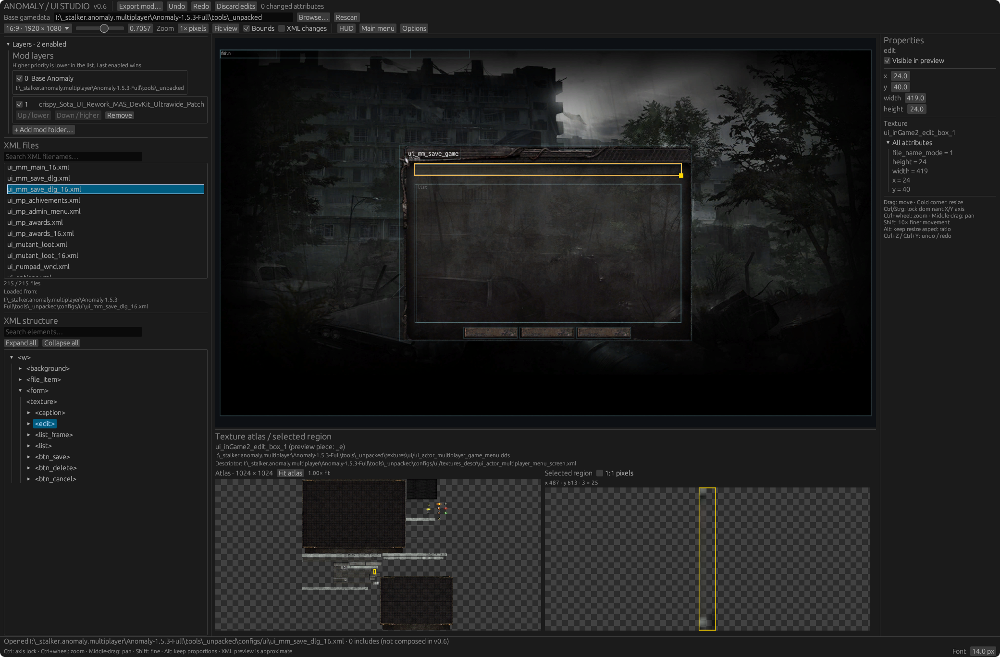
    </td>
    <td width="33%">
      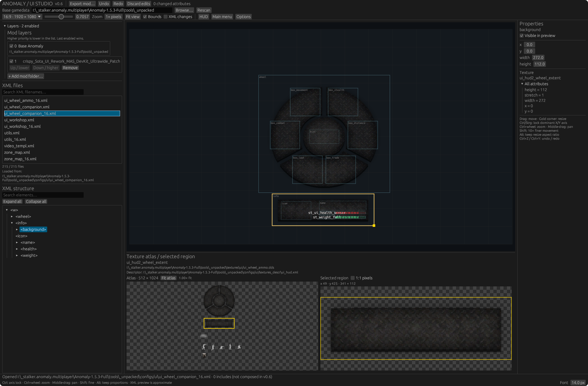
    </td>
  </tr>
  <tr>
    <td>
      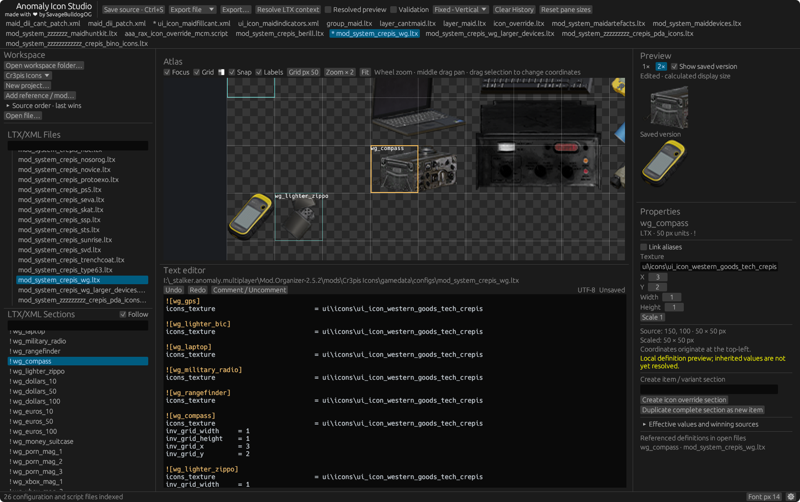
    </td>
    <td>
      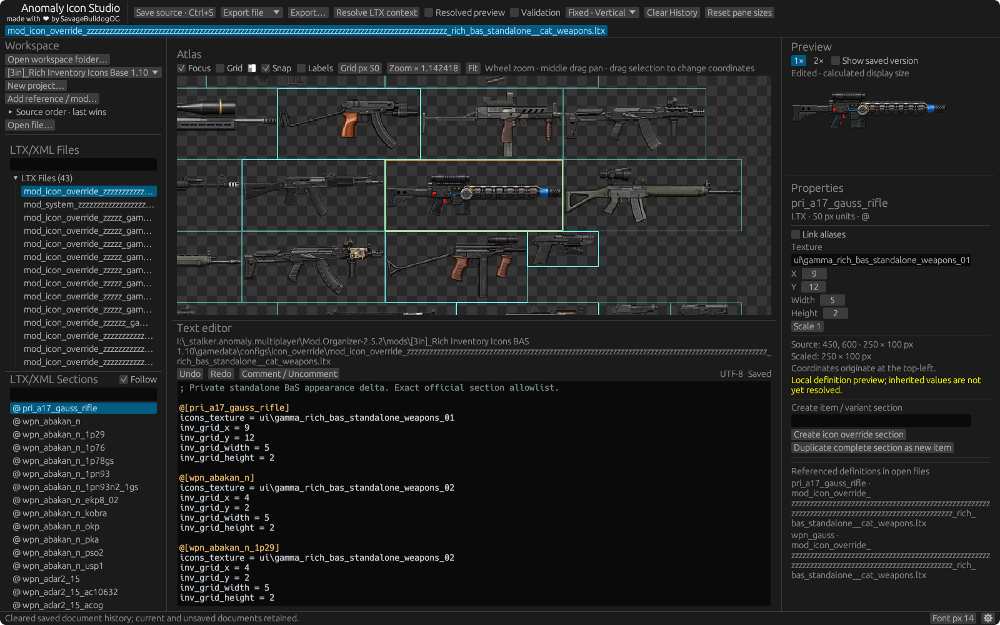
    </td>
    <td>
      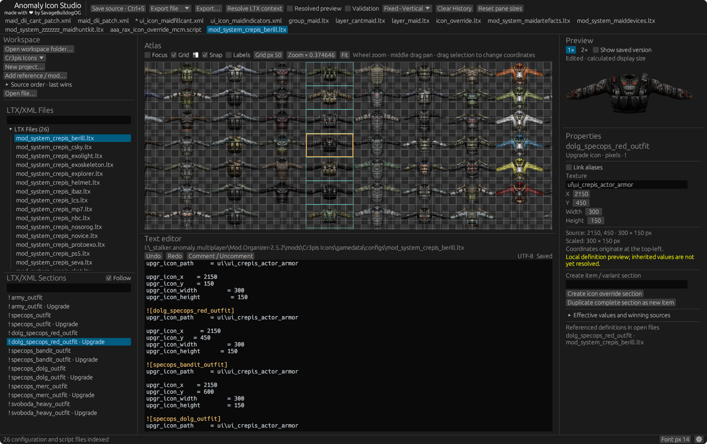
    </td>
  </tr>
  <tr>
    <td>
      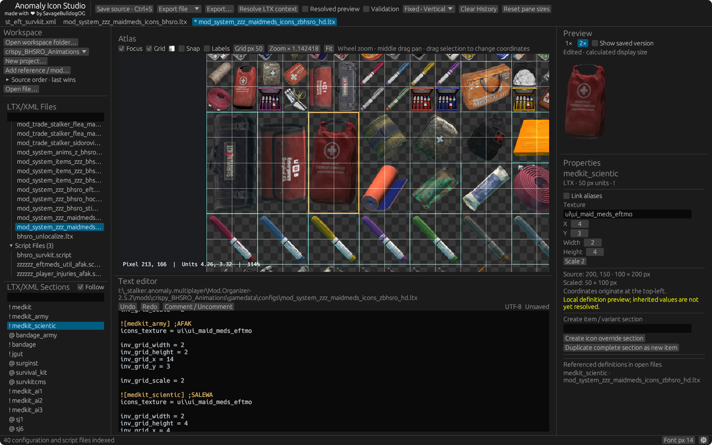
    </td>
    <td>
      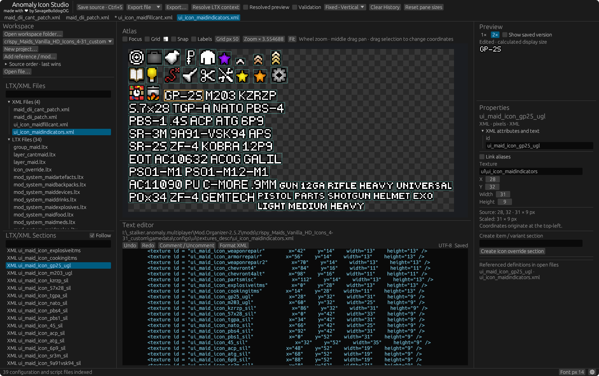
    </td>
    <td>
      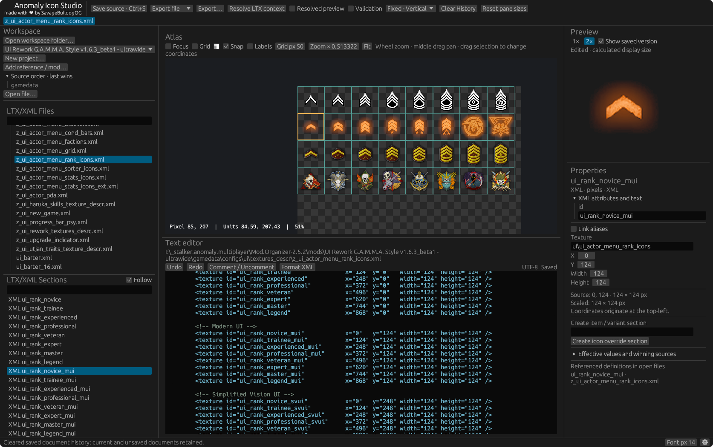
    </td>
  </tr>
</table>

## License

Distributed under the [MIT License](LICENSE). Original editor copyright and permission notices are retained in [Icons](editors/icons/LICENSE) and [UI Layout](editors/layout/LICENSE).

---

[crispy_anomaly_ui_studio](https://github.com/SBDG-0/crispy_anomaly_ui_studio)

---

made with ❤️ by SavageBulldogOG
